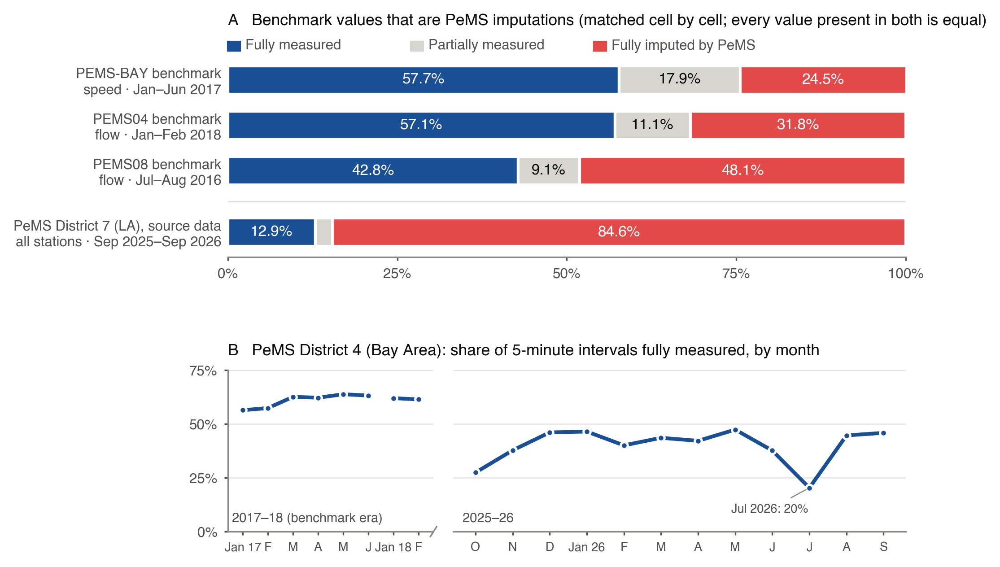

# Three widely used PeMS traffic benchmarks contain unflagged imputed values: a cell-level provenance audit of PEMS-BAY, PEMS04 and PEMS08

**Hayk Hakobyan** · VLO Labs, Inc. · hayk@vlolabs.com · Version 1.0, October 2026

---

## Abstract

The Caltrans Performance Measurement System (PeMS) records, for every detector station and 5-minute
interval, how much of the reported value was measured and how much was imputed. Three widely used
spatio-temporal forecasting benchmarks derived from PeMS (PEMS-BAY, PEMS04 and PEMS08) are distributed
without that record. We matched every value in the released files against the PeMS station records they
were drawn from. Every value present in both sources is identical (for PEMS04 and PEMS08, under their
inferred time windows and a recovered node-to-station mapping). **24.5% of PEMS-BAY speed values, 31.8%
of PEMS04 flow values and 48.1% of PEMS08 flow values fall on intervals that PeMS marks as fully
imputed.** They are PeMS's imputed numbers, carried into the benchmarks without a flag. PEMS04 and PEMS08
also contain groups of nodes whose entire series are identical: 20 of 307 and 25 of 170 nodes. Each group
traces to a PeMS station that was 100% imputed throughout the window. For the same 282 PEMS-BAY sensors
still reporting today, the fully imputed share has risen from 24.5% (2017) to 54.1% (2025–26). We release
the audit code so anyone with a free PeMS account can reproduce these results.

## 1. Background

PeMS aggregates 30-second loop-detector readings into 5-minute station records for California's state
highways [1]. Missing or faulty readings are filled by an imputation procedure that uses neighboring
detectors and historical patterns [2]. Each station record carries a `% observed` field: 100 means every
lane in the interval was measured, 0 means the whole value was imputed, and values in between are partial.

PeMS data underlie several standard benchmarks for traffic forecasting with graph and sequence models:
PEMS-BAY (speed, 325 Bay Area sensors) introduced with DCRNN [3]; PEMS04 and PEMS08 (flow, occupancy and
speed) released with ASTGCN [4]; PEMS03 and PEMS07 released with STSGCN [5]; and the larger LargeST
collection [6]. This report audits PEMS-BAY, PEMS04 and PEMS08. None of the three files carries
per-value provenance.

## 2. Data

**Benchmark files**, taken from the authors' own distributions:

| Benchmark | Source | Content |
|---|---|---|
| PEMS-BAY | DCRNN repository [3]; `pems-bay.h5` on the Google Drive linked from its README | speed; 325 columns = PeMS station IDs; 52,116 rows of naive local time, 2017-01-01 00:00 → 2017-06-30 23:55 (52,128 steps minus the 12 missing at the 2017-03-12 daylight-saving change) |
| PEMS04 | ASTGCN repository [4], `data/PEMS04/pems04.npz` | array (16992, 307, 3): flow, occupancy, speed; nodes numbered 0–306; no timestamps |
| PEMS08 | ASTGCN repository [4], `data/PEMS08/pems08.npz` | array (17856, 170, 3); nodes numbered 0–169; no timestamps |

SHA-256 of the files audited:
`pems-bay.h5` 65d69fb0a2323dba9867179eb7af47c8b814186bc459ff0a4937d21614153c8f ·
`pems04.npz` 95a3c9b720fffdb85f0330d09bfab41b0b3cad0ca86c0d7d5f3accacb4ac999a ·
`pems08.npz` e1d03ce74e9fb79149e6e7c37c680214822c4a285baa2f42278cacabcd25c075

PEMS04 and PEMS08 contain 16,992 and 17,856 five-minute steps (59 and 62 days). We used the windows most
often reported for them: 2018-01-01 → 2018-02-28 (PEMS04) and 2016-07-01 → 2016-08-31 (PEMS08). Under
these windows every node matches a PeMS station exactly over the full window (Section 3). We also tested
2018-07-01 → 2018-08-31 for PEMS08, which some secondary sources give: no node matches. Neither window
crosses a daylight-saving change, so the absence of matches is not a time-shift artefact.

**PeMS records:** Clearinghouse `station_5min` files for District 4 (2017-01-01 → 2017-06-30, 181 files;
2018-01-01 → 2018-02-28, 59 files) and District 8 (2016-07-01 → 2016-08-31, 62 files), retrieved in
October 2026. Timestamps are naive Pacific local time, as in PEMS-BAY. For context we also summarize
District 4 for 2025-10 → 2026-09 (363 of 365 daily files available) and District 7 (Los Angeles) for
2025-09-27 → 2026-09-25 (362 of 364).

## 3. Method

**Matching.** Each benchmark cell (timestamp, station, value) is joined to the PeMS record for the same
station and timestamp. PEMS-BAY speed is compared with PeMS `avg_speed`, and PEMS04/PEMS08 flow with PeMS
`total_flow`. Equality is exact; no tolerance is applied. Both sides hold the same decimal values (speed
to 0.1 mph, flow as integers), so exact comparison is well defined. Each cell is classed by the PeMS
record's `% observed`: measured (100), partial (1–99), imputed (0), or *no PeMS record* where PeMS has no
row for that station and timestamp. Only the flow channel of PEMS04 and PEMS08 is audited; occupancy and
speed come from the same PeMS records.

**Re-identifying PEMS04 and PEMS08 nodes.** For each node, candidate stations are those whose
`total_flow` equals the node's flow on at least 95% of the 288 steps of the first day. Each candidate is
scored by the number of identical cells over the whole window, and the best score wins. Some nodes tie
between several stations whose flow is identical over the entire window (Section 4.3). Our default
assignment takes the lowest station ID, and we report the range of the imputed share over every possible
choice among tied stations. That range has zero width for both benchmarks, so the choice does not affect
any reported share.

## 4. Results



**Figure 1.** *(A)* Share of benchmark values on intervals PeMS marks as fully measured, partially
measured or fully imputed. Every value present in both sources is identical, so the red segments are PeMS
imputations carried into the benchmarks. Bottom bar: a year of current PeMS source data for Los Angeles
(District 7), for context. *(B)* Monthly share of fully measured intervals across all District 4 (Bay
Area) stations, in the period PEMS-BAY and PEMS04 were drawn from and in 2025–26. The gap between periods
is not drawn. Shares may not sum to exactly 100% because of rounding.

### 4.1 Benchmark values are PeMS values, including imputed ones

| Benchmark | Cells | Fully measured | Partially measured | **Fully imputed** | Identical to PeMS |
|---|---|---|---|---|---|
| PEMS-BAY (speed) | 16,937,700 | 57.7% | 17.9% | **24.5%** | 16,937,179 (every cell for which PeMS has a value) |
| PEMS04 (flow) | 5,216,544 | 57.1% | 11.1% | **31.8%** | 5,216,544 (100%) |
| PEMS08 (flow) | 3,035,520 | 42.8% | 9.1% | **48.1%** | 3,035,520 (100%) |

The only PEMS-BAY cells that are not identical are 521 zeros, all where PeMS has no value. 389 fall on
three 5-minute intervals for which PeMS has no record for some sensors (2017-04-20 01:40, 2017-05-05 19:55
and 2017-06-15 01:00). The other 132 are imputed intervals for which PeMS publishes no speed. The
benchmark encodes these gaps as 0. DCRNN's reference implementation masks zeros (`null_val=0`) in both
its loss and its evaluation metrics [3], so these cells are excluded from its scoring. The imputed values,
by contrast, are non-zero and are scored.

### 4.2 Imputation is concentrated in a subset of sensors

In PEMS-BAY, 200 sensors are fully imputed on fewer than 10% of their intervals, 65 on 10–50%, 14 on
50–90%, and **46 sensors (14%) on at least 90%**. The series of those 46 sensors in the benchmark are
almost entirely the output of PeMS's imputation. On 2017-01-01 and 2017-01-02 none of the 187,200
benchmark-sensor intervals is fully measured, yet both days appear complete in the released file.

### 4.3 PEMS04 and PEMS08 contain duplicated, wholly imputed nodes

Some benchmark nodes have flow series that are identical to each other at every one of the window's
steps:

| Benchmark | Duplicated nodes | Groups (nodes each) | PeMS status of the matched station |
|---|---|---|---|
| PEMS04 | 20 of 307 (6.5%) | 2 (15, 5) | 100% imputed in every interval of the window |
| PEMS08 | 25 of 170 (14.7%) | 4 (8, 8, 7, 2) | 100% imputed in every interval of the window |

These are not empty series: each has 145–326 distinct values. In PeMS the same series is carried by
between 36 and 95 stations per group, so the series appears to be a common imputation profile applied to stations
that measured nothing. Some duplicated nodes are directly connected in the benchmark's road graph (for
example, 10 edges among the 15-node PEMS04 group), so graph models see identical neighbors.

### 4.4 The source has degraded since the benchmarks were built

For the same PEMS-BAY sensors, the fully measured share fell from 57.7% (Jan–Jun 2017, 325 sensors) to
35.8% (Oct 2025 – Sep 2026, the 282 sensors still reporting), and the fully imputed share rose from 24.5%
to 54.1%. Across all District 4 stations, the monthly fully measured share was 56–64% in January–June 2017
and 61–62% in January–February 2018, against 20–47% between October 2025 and September 2026 (Figure 1B).
In District 7 over 2025-09-27 → 2026-09-25 (4,925 stations, 509 million intervals), 12.9% of intervals
were fully measured and 84.6% fully imputed. A dataset built today from these districts without
provenance would carry a larger imputed share than the benchmarks above.

## 5. Implications

- **Evaluation targets include imputed values.** Under the standard protocols, a quarter to a half of the
  scored targets are PeMS imputations. Errors on those targets partly measure agreement with PeMS's
  imputation rather than observed traffic.
- **Inputs include imputed and duplicated values.** Models may partly learn the imputation procedure's
  regularities, and graph models in PEMS04/PEMS08 see some neighborhoods made of identical copies.
- **The effect on published results is untested.** We do not claim that any reported ranking changes.
  Re-scoring standard models on measured targets only is the obvious next step, and this release makes
  it straightforward: the class of every benchmark cell can be regenerated with the code.
- **A low-cost fix exists.** Benchmarks derived from PeMS can ship PeMS's `% observed` (or a
  measured/imputed mask) alongside every value, and keep station IDs so provenance stays recoverable.

## 6. Limitations

- PeMS may reprocess historical data. The exact equality we observe indicates that the archived values
  we retrieved in 2026 are the values the benchmarks contain, but we cannot rule out later changes to the
  `% observed` field itself.
- The PEMS04 and PEMS08 windows are inferred, not recorded in the files. The evidence for them is that
  every node matches exactly under them. For PEMS08 the main alternative window does not match. We did
  not test alternatives for PEMS04.
- PEMS03, PEMS07 and LargeST are not audited here. LargeST's published processing averages to 15-minute
  intervals and fills gaps with zeros [7], so PeMS-imputed values would pass through. Its audit needs
  different matching because the values are averages.
- The duplicated-node interpretation (a shared imputation profile) is inferred from the data; PeMS does
  not document it per station.

## 7. Reproducibility

Code: https://github.com/VLO-Labs/pems-provenance-audit **[CONFIRM org / repo name]**. It runs on Python
3.11+ (tested on 3.12). Each audit runs in under 10 seconds on a 24-core workstation, with a peak of
about 7.5 GB RAM. The PeMS inputs total about 7.5 GB.

```sh
pip install -r requirements.txt
export PEMS_USERNAME=... PEMS_PASSWORD=...      # free PeMS account
python fetch_pems.py --district 4 --from 2017-01-01 --to 2017-06-30 --out pems/d04/2017
python fetch_pems.py --district 4 --from 2018-01-01 --to 2018-02-28 --out pems/d04/2018
python fetch_pems.py --district 8 --from 2016-07-01 --to 2016-08-31 --out pems/d08/2016
python pems_audit.py pems-bay --h5 pems-bay.h5 --pems-dir pems/d04/2017 --per-sensor bay_per_sensor.csv
python pems_audit.py astgcn --npz pems04.npz --start 2018-01-01 --pems-dir pems/d04/2018 --mapping pems04_map.csv
python pems_audit.py astgcn --npz pems08.npz --start 2016-07-01 --pems-dir pems/d08/2016 --mapping pems08_map.csv
```

We do not redistribute PeMS data or the benchmark files.

## References

1. C. Chen, K. Petty, A. Skabardonis, P. Varaiya, Z. Jia. Freeway Performance Measurement System: Mining
   Loop Detector Data. *Transportation Research Record*, 1748(1):96–102, 2001. doi:10.3141/1748-12
2. C. Chen, J. Kwon, J. Rice, A. Skabardonis, P. Varaiya. Detecting Errors and Imputing Missing Data for
   Single-Loop Surveillance Systems. *Transportation Research Record*, 1855(1):160–167, 2003.
   doi:10.3141/1855-20
3. Y. Li, R. Yu, C. Shahabi, Y. Liu. Diffusion Convolutional Recurrent Neural Network: Data-Driven Traffic
   Forecasting. *ICLR*, 2018. arXiv:1707.01926. Code and data: https://github.com/liyaguang/DCRNN
4. S. Guo, Y. Lin, N. Feng, C. Song, H. Wan. Attention Based Spatial-Temporal Graph Convolutional Networks
   for Traffic Flow Forecasting. *AAAI*, 33(01):922–929, 2019. doi:10.1609/aaai.v33i01.3301922. Code and
   data: https://github.com/wanhuaiyu/ASTGCN
5. C. Song, Y. Lin, S. Guo, H. Wan. Spatial-Temporal Synchronous Graph Convolutional Networks: A New
   Framework for Spatial-Temporal Network Data Forecasting. *AAAI*, 34(01):914–921, 2020.
   doi:10.1609/aaai.v34i01.5438
6. X. Liu, Y. Xia, Y. Liang, J. Hu, Y. Wang, L. Bai, C. Huang, Z. Liu, B. Hooi, R. Zimmermann. LargeST: A
   Benchmark Dataset for Large-Scale Traffic Forecasting. *NeurIPS Datasets and Benchmarks*, 2023.
   arXiv:2306.08259
7. LargeST repository, data processing notebook `data/ca/process_ca_his.ipynb`.
   https://github.com/liuxu77/LargeST (accessed October 2026)
